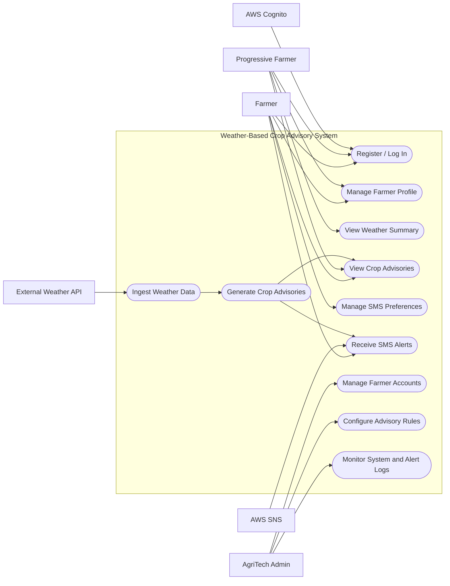

# Experiment 5 — UML Use Case Modeling

## Aim
To identify system actors and use cases and document the functional interactions of the Weather-Based Crop Advisory System.

## Tools
StarUML, Draw.io / diagrams.net, or PlantUML.

## System scope
The system provides farmer registration/login, profile management, weather-based crop advisories, dashboard access, SMS alerts, and administrative monitoring/configuration.

## Actors
- **Farmer:** registers/logs in, maintains crop and location details, views advisories, and manages SMS preferences.
- **Progressive Farmer:** a farmer who uses the web dashboard for detailed weather/advisory information. This is a user profile/type, not a separate backend role.
- **AgriTech Admin:** manages farmer accounts, advisory rules, and system monitoring.
- **External Weather API:** provides current and forecast weather data.
- **AWS Cognito:** authenticates users and issues JWT tokens.
- **AWS SNS:** delivers SMS alerts.

## Use case diagram

> In a formal UML tool, draw a system boundary rectangle and use association lines between actors and use cases. The Mermaid diagram above is a GitHub-friendly overview; use the `.puml` file for a more UML-style version.

## Use case descriptions / narratives

### UC-01: Register or Log In
- **Primary actor:** Farmer / Progressive Farmer
- **Supporting system:** AWS Cognito
- **Goal:** Access the advisory system securely.
- **Preconditions:** User has access to the web interface and a valid mobile number.
- **Trigger:** User selects Register or Log In.
- **Main flow:**
  1. System displays registration/login form.
  2. For registration, user enters name, mobile number, and password.
  3. System sends credentials to AWS Cognito.
  4. Cognito creates the account or validates the login.
  5. On successful login, Cognito issues a JWT and the dashboard opens.
- **Alternate / exception flows:**
  - Invalid credentials: show a clear error message.
  - Five consecutive failed login attempts: lock the account according to the SRS.
  - Password forgotten: user requests an OTP reset on the registered mobile number.
- **Postconditions:** User is authenticated, or an appropriate error is shown.

### UC-02: Manage Farmer Profile
- **Primary actor:** Farmer
- **Goal:** Maintain crop type, farm location, and SMS preference.
- **Preconditions:** Farmer is authenticated.
- **Trigger:** Farmer opens the Profile page.
- **Main flow:**
  1. System displays current profile details.
  2. Farmer updates crop type, location, or SMS preference.
  3. System validates the supplied information.
  4. System stores the updated profile in DynamoDB.
  5. Updated profile is used in the next advisory run.
- **Alternate flow:** Missing crop type or location is flagged; advisories are not generated until profile setup is complete.
- **Postconditions:** Profile is updated or validation errors are displayed.

### UC-03: View Crop Advisories
- **Primary actor:** Farmer / Progressive Farmer
- **Goal:** View irrigation, sowing-window, frost, heat, and spray recommendations.
- **Preconditions:** Farmer is authenticated and has completed crop/location profile setup.
- **Trigger:** Farmer opens the dashboard or selects an advisory card.
- **Main flow:**
  1. System requests current advisory and weather summary data.
  2. Backend reads the farmer profile and latest advisory records.
  3. System displays advisory cards and the 24-hour weather summary.
  4. Farmer selects a card to view its details.
- **Alternate flow:** If weather data is unavailable or older than three hours, the system must not issue new advice based on stale data and should notify the administrator.
- **Postconditions:** Farmer sees the available advisory information.

### UC-04: Ingest Weather Data
- **Primary actor:** AWS EventBridge (scheduled trigger)
- **Supporting actor:** External Weather API
- **Goal:** Obtain current and 24-hour forecast data.
- **Preconditions:** API credentials/configuration are available and the scheduled rule is enabled.
- **Trigger:** Hourly EventBridge schedule.
- **Main flow:**
  1. EventBridge invokes the Weather Ingestion Lambda.
  2. Lambda requests weather data for registered farm locations.
  3. Lambda validates and timestamps the response.
  4. Data is saved in DynamoDB.
  5. Successful ingestion triggers the Advisory Engine.
- **Alternate flow:** On API failure, retry up to three times, then log the error and notify the administrator as appropriate.
- **Postconditions:** Latest weather data is stored, or a failure is logged.

### UC-05: Generate Crop Advisories
- **Primary actor:** Advisory Engine (system process)
- **Goal:** Generate crop-specific, rule-based recommendations.
- **Preconditions:** Recent weather data and a complete farmer profile are available.
- **Trigger:** Successful weather ingestion.
- **Main flow:**
  1. Engine reads the latest weather data and farmer crop/location profile.
  2. It applies configured crop-specific rules.
  3. It generates irrigation and sowing recommendations.
  4. It generates a frost warning below 2°C, a heat warning above 40°C, and a spray advisory when wind is below 15 km/h and no rain is forecast.
  5. It stores the advisories and flags relevant alerts for delivery.
- **Alternate flow:** If input data is stale or missing, do not generate an advisory from stale data; log the issue.
- **Postconditions:** Advisory records are stored and eligible alerts are queued/flagged.

### UC-06: Manage System (Admin)
- **Primary actor:** AgriTech Admin
- **Goal:** Manage farmer accounts, configure thresholds, and monitor system health.
- **Preconditions:** Admin is authenticated and belongs to the `admin` Cognito group.
- **Trigger:** Admin opens the admin panel.
- **Main flow:**
  1. System verifies admin authorization.
  2. Admin views farmer counts, active sessions, recent SMS logs, and system health.
  3. Admin enables/disables a farmer account or changes advisory thresholds.
  4. System validates and saves changes.
  5. Updated rules are used in subsequent advisory runs.
- **Alternate flow:** Unauthorized user is denied access; invalid threshold values are rejected.
- **Postconditions:** Requested administrative changes are saved and audit/log records are available.

### UC-07: Deliver SMS Alert
- **Primary actor:** Alert Service
- **Supporting actor:** AWS SNS
- **Goal:** Deliver concise and timely advisory alerts to a farmer.
- **Preconditions:** A warning/daily summary is ready, the farmer has a valid mobile number, and SMS alerts are enabled.
- **Trigger:** Advisory engine flags an alert or the daily summary schedule runs.
- **Main flow:**
  1. Alert Service formats the message in plain, actionable language.
  2. It checks the farmer's SMS preference.
  3. It sends the message through AWS SNS.
  4. It records delivery status in DynamoDB.
- **Alternate flow:** If SMS is opted out, do not send; if delivery fails, record the failure.
- **Postconditions:** SMS delivery attempt and status are logged.

## Deliverable checklist
- [x] Actor identification
- [x] Use case diagram
- [x] Use case description template
- [x] Use case narratives
