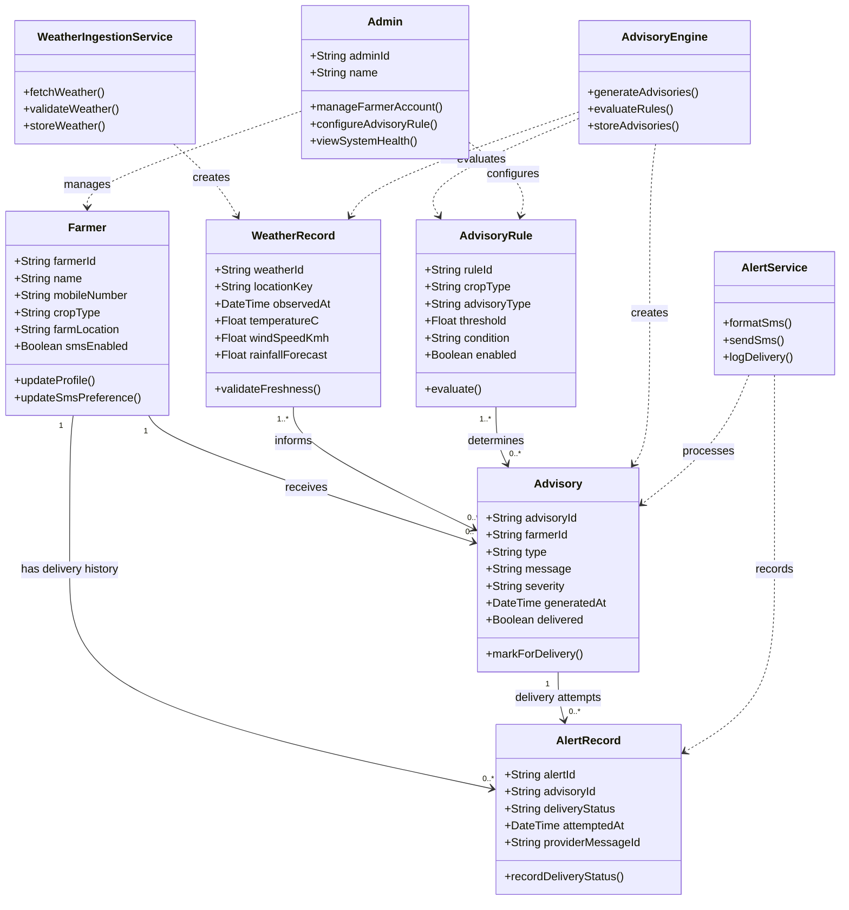

# Experiment 6 — UML Class Diagram Design

## Aim
To identify the main domain classes, attributes, operations, and relationships for the Weather-Based Crop Advisory System.

## Analysis
The classes represent the system's domain and logical responsibilities. AWS services are shown as external integrations, not as ordinary domain entities.

## Class diagram

## Class responsibilities

| Class | Responsibility |
|---|---|
| `Farmer` | Stores the farmer profile, crop, location, and SMS preference. Authentication credentials remain managed by AWS Cognito. |
| `Admin` | Represents administrative actions such as account management and rule configuration. |
| `WeatherRecord` | Represents timestamped current/forecast weather data. |
| `Advisory` | Represents a generated crop-specific recommendation or warning. |
| `AdvisoryRule` | Stores configurable rule conditions and thresholds. |
| `AlertRecord` | Tracks SMS delivery attempts and statuses. |
| `WeatherIngestionService` | Fetches, validates, and persists weather data. |
| `AdvisoryEngine` | Applies rules to weather/profile data and creates advisories. |
| `AlertService` | Formats SMS, requests delivery via SNS, and records status. |

## Relationships and multiplicity
- One farmer may receive zero or many advisories.
- One advisory may have zero or many delivery-attempt records.
- Multiple weather records can inform multiple advisories.
- Advisory rules are evaluated to determine the applicable advisory type.
- Service classes depend on domain classes to perform their operations.
- AWS Cognito remains the source of authentication; passwords are not stored in the `Farmer` class.

## Design note
These are logical classes. In an implementation using DynamoDB, the data may be stored in denormalized items/tables rather than relational tables. The UML relationships express domain associations, not a requirement to use a relational database.
