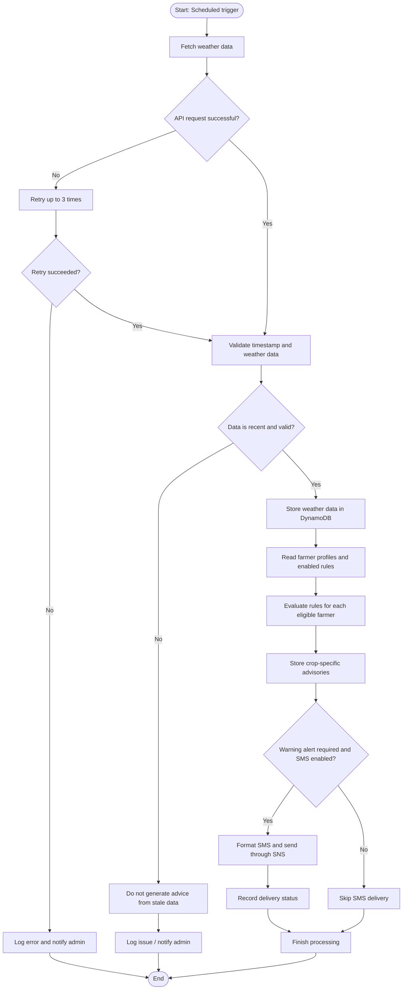

# Experiment 7 — UML Sequence and Activity Diagram Modeling

## Aim
To model message flow between actors/components and represent the end-to-end workflow for weather ingestion, advisory generation, and SMS delivery.

## Sequence diagram: Weather-to-advisory-to-SMS workflow

```mermaid
sequenceDiagram
    participant EB as AWS EventBridge
    participant WI as Weather Ingestion Lambda
    participant API as External Weather API
    participant DB as DynamoDB
    participant AE as Advisory Engine Lambda
    participant AS as Alert Service Lambda
    participant SNS as AWS SNS
    participant F as Farmer

    EB->>WI: Trigger hourly ingestion
    WI->>API: Request current + 24-hour forecast
    API-->>WI: Weather response
    WI->>WI: Validate data and timestamp
    WI->>DB: Store weather record
    WI->>AE: Trigger advisory generation
    AE->>DB: Read recent weather, profiles, rules
    DB-->>AE: Return required records
    AE->>AE: Evaluate crop-specific rules
    AE->>DB: Store advisory and flag warnings
    alt Warning found and SMS enabled
      AE->>AS: Trigger alert processing
      AS->>DB: Read farmer preferences and phone
      DB-->>AS: Return contact/preferences
      AS->>SNS: Publish concise SMS
      SNS-->>AS: Delivery request result/message ID
      AS->>DB: Record delivery status
      SNS-->>F: SMS alert
    else No warning or SMS opted out
      AE->>DB: Keep advisory; no SMS dispatch
    end
```

## Activity diagram: Advisory generation workflow



## Workflow explanation
1. EventBridge schedules weather ingestion every hour.
2. The Weather Ingestion Lambda retrieves current and forecast weather from the external API.
3. The system validates the response and stores timestamped data in DynamoDB.
4. The Advisory Engine reads recent weather, farmer profiles, and enabled rules.
5. The engine generates crop-specific advisories and stores them.
6. If an alert is applicable and SMS is enabled, the Alert Service publishes it through SNS.
7. Delivery status and failures are logged for monitoring.

## Modeling assumptions
- Retry attempts are limited to three, as specified in the SRS.
- Data older than three hours must not be used to issue new advisories.
- Advisory generation is rule-based in Version 1.0.
- The diagram is a logical workflow; exact Lambda invocation/event wiring can be finalized during implementation.
