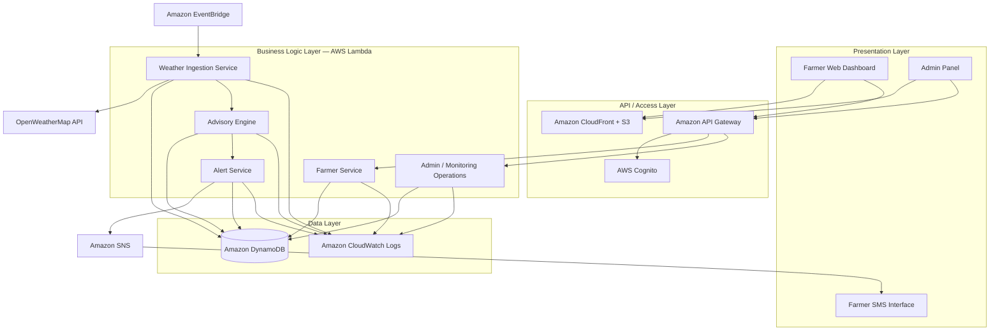

# Experiment 9 — Software Architecture Design and Design Patterns

## Aim
To represent the Weather-Based Crop Advisory System using layered architecture, client-server architecture, and a conceptual microservices view.

## 1. Layered architecture diagram

## 2. Client-server architecture
- **Clients:** Farmer dashboard and admin panel in a web browser; farmers may also receive SMS on basic mobile phones.
- **Server-side/API entry:** API Gateway exposes backend endpoints.
- **Authentication:** AWS Cognito validates users and issues JWT tokens.
- **Application processing:** Lambda functions execute profile, weather, advisory, alert, and admin operations.
- **Persistence:** DynamoDB stores farmer profiles, weather records, advisories, rules, and alert status.
- **External dependency:** OpenWeatherMap supplies weather data; SNS sends SMS messages.

The browser does not directly access DynamoDB. It communicates with the backend through API Gateway and authorized APIs.

## 3. Conceptual microservices architecture
The SRS identifies four independently deployable services:

| Service | Responsibility | Main AWS integrations |
|---|---|---|
| Farmer Service | Profile operations and user-related workflows | Cognito, DynamoDB |
| Weather Service | Scheduled weather retrieval and storage | EventBridge, Lambda, external weather API, DynamoDB |
| Advisory Engine | Rule evaluation and advisory generation | Lambda, DynamoDB |
| Alert Service | SMS formatting, dispatch, and delivery status | Lambda, SNS, DynamoDB |

These are logical service boundaries. A fully serverless implementation may use multiple Lambda functions within each service boundary.

## 4. Design patterns / architectural patterns
- **Layered architecture:** separates presentation, access, business logic, and data responsibilities.
- **Client-server:** web clients request operations from backend APIs.
- **Event-driven architecture:** EventBridge triggers scheduled weather ingestion; successful ingestion initiates advisory processing.
- **Microservices (conceptual):** farmer, weather, advisory, and alert responsibilities are separated into independently deployable service boundaries.
- **Adapter / integration boundary (design suggestion):** wrap the external weather API and SNS calls behind small interfaces so provider-specific details do not spread throughout business logic.

The adapter is a recommended implementation design, not a stated requirement that a particular code library must be used.

## 5. Architecture flow
1. Farmer/admin loads the static web application from S3 through CloudFront.
2. User authenticates with Cognito and receives a JWT.
3. Browser sends authorized API requests through API Gateway.
4. Lambda functions validate the request and perform business logic.
5. DynamoDB stores and retrieves application data.
6. EventBridge triggers weather ingestion on a schedule.
7. The Weather Service retrieves weather data and stores it.
8. The Advisory Engine applies rules and persists crop-specific advisories.
9. The Alert Service sends eligible SMS alerts through SNS and records delivery status.
10. CloudWatch collects logs and supports operational monitoring.

## 6. Nonfunctional considerations
- **Security:** HTTPS/TLS, Cognito JWT authentication, and admin-group authorization.
- **Performance:** dashboard target under three seconds; advisory/alert processing target within five minutes.
- **Reliability:** retries for weather API failures and no new advice from weather data older than three hours.
- **Scalability:** serverless execution and managed services.
- **Cost management:** tag AWS resources by project/environment and monitor usage.

## 7. Conclusion
A layered, client-server design with event-driven processing and conceptual microservice boundaries fits the requirements of the Weather-Based Crop Advisory System. It separates user interaction from business logic and persistence while supporting scheduled weather processing and timely SMS alerts.

## Deliverable checklist
- [x] Layered architecture diagram
- [x] Client-server architecture explanation
- [x] Conceptual microservices mapping
- [x] Architecture flow and design considerations
